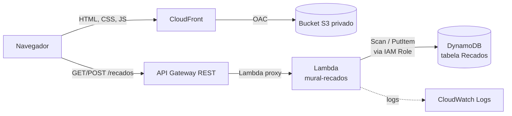

# Lab: Mural de Recados com S3, CloudFront, API Gateway, Lambda e DynamoDB

Neste laboratório vamos publicar um site estático (pasta `site/`) que lista e grava recados.
Toda a criação dos recursos é feita manualmente pelo Console da AWS.

## Arquitetura



- **S3** guarda os arquivos do site. O bucket fica privado.
- **CloudFront** entrega o site com HTTPS e é o único que lê o bucket (Origin Access Control).
- **API Gateway** expõe `GET /recados` e `POST /recados` e repassa cada requisição para a Lambda.
- **Lambda** valida os dados, gera o `id` e a data do recado, e lê/grava no DynamoDB.
- **DynamoDB** armazena os recados.
- **CloudWatch Logs** recebe os logs da Lambda, útil para depurar.

## Estrutura do projeto

```
lab02/
├── PASSO-A-PASSO.md
├── .aws-profile      <- profile do AWS CLI usado pelos scripts
├── .aws-region       <- região usada pelos scripts
├── infra/            <- deploy automatizado (opcional, ver "Atalho")
│   ├── template.yaml
│   ├── deploy.sh
│   ├── destroy.sh
│   ├── status.sh
│   ├── smoke-test.sh
│   └── aws-env.sh
├── lambda/
│   └── index.mjs     <- código da função Lambda (Node.js)
└── site/
    ├── index.html
    ├── styles.css
    ├── app.js
    └── config.js     <- aqui vai a URL da API
```

## Atalho: deploy automatizado (CloudFormation)

A pasta `infra/` cria o mesmo ambiente deste guia em uma única stack CloudFormation. É útil para o professor montar uma demonstração pronta.

| Arquivo | Função |
|---|---|
| `infra/template.yaml` | Todos os recursos: DynamoDB, IAM Role, Lambda, Log group, API Gateway, S3, OAC e CloudFront |
| `infra/deploy.sh` | Cria/atualiza a stack, publica `lambda/index.mjs`, gera `site/config.js`, envia o site ao S3 e invalida o cache |
| `infra/destroy.sh` | Esvazia o bucket e apaga a stack inteira |
| `infra/status.sh` | Mostra o status e os últimos eventos da stack (somente leitura) |
| `infra/smoke-test.sh` | Testa site, bloqueio do S3, GET, CORS, preflight e validação do POST, sem gravar dados |
| `infra/aws-env.sh` | Lê `.aws-profile` e `.aws-region` da raiz do projeto |

Na raiz do projeto, com `.aws-profile` e `.aws-region` preenchidos:

```bash
bash infra/deploy.sh 2>&1 | tee deploy.log
```

As diferenças em relação ao passo a passo manual:

- Os nomes levam o prefixo da stack: tabela `mural-recados-recados`, função `mural-recados`, API `mural-recados-api`. O bucket recebe um nome gerado pelo CloudFormation.
- O CORS já fica restrito ao domínio do CloudFront, e não `*`. Abrir o `index.html` direto do computador não vai funcionar contra essa API.
- O stage `prod` tem throttling de 10 requisições por segundo (rajada de 20).
- A role da Lambda só pode gravar no log group dela, que guarda os logs por 7 dias.

Para apagar tudo (os recados são perdidos):

```bash
bash infra/destroy.sh 2>&1 | tee destroy.log
```

## O que a Lambda faz

O arquivo `lambda/index.mjs` recebe o evento do API Gateway e decide pelo método HTTP:

| Método | Ação | Resposta |
|---|---|---|
| `GET /recados` | `Scan` na tabela, ordena do mais novo para o mais antigo | `200` com a lista |
| `POST /recados` | Valida `nome` (até 50 caracteres) e `mensagem` (até 280), gera `id` (UUID) e `criadoEm` (epoch em ms), faz `PutItem` | `201` com `{ ok, id }` ou `400` com `{ erro }` |
| outros | | `405` |

Ela também devolve os cabeçalhos de CORS em todas as respostas. Na integração **Lambda proxy**, o API Gateway não mexe na resposta, então quem precisa mandar `Access-Control-Allow-Origin` é a própria função.

O código usa o AWS SDK for JavaScript v3, que já vem no runtime Node.js da Lambda. Não é preciso instalar pacotes nem montar um `.zip`: basta colar o código no editor do console.

## Antes de começar

- Escolha **uma região** e use a mesma em todos os serviços (exemplo: `us-east-1`). Confira no canto superior direito do console.
- Anote em um bloco de notas: **ID da conta**, **região**, **ARN da tabela**, **Invoke URL da API** e **domínio do CloudFront**.
- Faremos o backend primeiro. Assim o `config.js` já sobe com a URL correta e não precisamos invalidar o cache do CloudFront depois.

---

## Passo 1: Criar a tabela no DynamoDB

1. Abra o console do **DynamoDB** e clique em **Tables** > **Create table**.
2. Preencha:
   - **Table name:** `Recados`
   - **Partition key:** `id`, tipo **String**
   - **Sort key:** deixe em branco
3. Em **Table settings**, deixe **Default settings**. Confira que o modo de capacidade é **On-demand** (se não for, escolha **Customize settings** e selecione **On-demand**).
4. Clique em **Create table** e aguarde o status **Active**.
5. Abra a tabela, aba **Overview** > **General information** > **Additional info**, e copie o **Amazon Resource Name (ARN)**. Exemplo:
   `arn:aws:dynamodb:us-east-1:123456789012:table/Recados`

---

## Passo 2: Criar a IAM Role da Lambda

A Lambda precisa de permissão para gravar logs e para ler e gravar na tabela. Vamos dar só o mínimo: `Scan` e `PutItem` nesta tabela.

1. Abra o console do **IAM** > **Roles** > **Create role**.
2. **Trusted entity type:** AWS service.
3. **Use case:** **Lambda**. Clique em **Next**.
4. Pesquise e marque a policy gerenciada **AWSLambdaBasicExecutionRole** (permite gravar no CloudWatch Logs). Clique em **Next**.
5. **Role name:** `lambda-mural-recados-role`. Clique em **Create role**.
6. Abra a role criada, clique em **Add permissions** > **Create inline policy** > aba **JSON** e cole (troque o ARN pelo da sua tabela):

   ```json
   {
     "Version": "2012-10-17",
     "Statement": [
       {
         "Effect": "Allow",
         "Action": [
           "dynamodb:Scan",
           "dynamodb:PutItem"
         ],
         "Resource": "arn:aws:dynamodb:us-east-1:123456789012:table/Recados"
       }
     ]
   }
   ```

7. Clique em **Next**, dê o nome `dynamodb-recados-acesso` e clique em **Create policy**.

---

## Passo 3: Criar a função Lambda

### 3.1 Criar a função

1. Abra o console do **Lambda** > **Create function**.
2. Escolha **Author from scratch** e preencha:
   - **Function name:** `mural-recados`
   - **Runtime:** **Node.js 22.x** (ou uma versão mais nova do Node.js, se aparecer)
   - **Architecture:** x86_64 (arm64 também funciona e é um pouco mais barata)
3. Em **Permissions**, abra **Change default execution role**:
   - Marque **Use an existing role**
   - Selecione `lambda-mural-recados-role`
4. Clique em **Create function**.

### 3.2 Colar o código

1. Na aba **Code**, abra o arquivo `index.mjs` no editor do console.
2. Apague o conteúdo e cole todo o conteúdo de `lambda/index.mjs` deste projeto.
3. Clique em **Deploy** e aguarde a mensagem de sucesso.
4. Confira em **Runtime settings** que o **Handler** é `index.handler` (arquivo `index.mjs`, função `handler`).

### 3.3 Configurar variáveis de ambiente e timeout

1. Aba **Configuration** > **Environment variables** > **Edit** > **Add environment variable**:

   | Key | Value |
   |---|---|
   | `TABLE_NAME` | `Recados` |
   | `ALLOWED_ORIGIN` | `*` |

   Clique em **Save**. Depois que o CloudFront estiver pronto, você pode trocar `*` pelo domínio dele (veja o Passo 7).

2. Aba **Configuration** > **General configuration** > **Edit**:
   - **Timeout:** `10` segundos (o padrão de 3 s pode ser curto na primeira execução)
   - **Memory:** pode deixar `128 MB`

   Clique em **Save**.

### 3.4 Testar a Lambda sozinha

1. Aba **Test** > **Create new event**.
2. **Event name:** `post-recado`. Em **Event JSON**, cole:

   ```json
   {
     "httpMethod": "POST",
     "path": "/recados",
     "body": "{\"nome\":\"Professor\",\"mensagem\":\"Primeiro recado do lab!\"}"
   }
   ```

   Repare que o `body` é uma **string** com JSON dentro, igual ao que o API Gateway envia.

3. Clique em **Save** e depois em **Test**. O resultado deve ter `"statusCode": 201`.
4. Crie outro evento `get-recados` com:

   ```json
   {
     "httpMethod": "GET",
     "path": "/recados"
   }
   ```

   Rode o teste. O `body` da resposta deve listar o recado que você acabou de criar.
5. No DynamoDB, abra a tabela `Recados` > **Explore table items** e confira o item.

Se der erro, clique em **View CloudWatch logs** (aba **Monitor**) para ver a mensagem completa.

---

## Passo 4: Criar a API no API Gateway

### 4.1 Criar a API e o recurso

1. Abra o console do **API Gateway** > **Create API**.
2. Em **REST API** (não a versão "Private"), clique em **Build**.
3. Preencha:
   - **API details:** New API
   - **API name:** `recados-api`
   - **API endpoint type:** Regional
4. Clique em **Create API**.
5. Com o recurso `/` selecionado, clique em **Create resource**:
   - **Resource path:** `/`
   - **Resource name:** `recados`
   - Deixe **CORS** desmarcado (vamos habilitar depois, já com os métodos criados).
6. Clique em **Create resource**.

### 4.2 Criar os métodos GET e POST

1. Selecione o recurso `/recados` > **Create method**.
2. Preencha:
   - **Method type:** GET
   - **Integration type:** Lambda function
   - **Lambda proxy integration:** **ativado**
   - **Lambda function:** selecione a sua região e a função `mural-recados`
   - **Integration timeout:** padrão
3. Clique em **Create method**. O console adiciona automaticamente a permissão para o API Gateway invocar a Lambda.
4. Repita para o **POST**: selecione `/recados` > **Create method**, **Method type:** POST, mesmas opções.

Com o **Lambda proxy integration** ativado, o API Gateway entrega a requisição inteira para a Lambda (método, caminho, cabeçalhos, corpo) e devolve ao navegador exatamente o que a Lambda retornar. Por isso não precisamos de mapping templates.

### 4.3 Testar no console

1. Selecione **POST** em `/recados` > aba **Test**.
2. Em **Request body**, cole:

   ```json
   { "nome": "Aluno", "mensagem": "Testando pelo API Gateway" }
   ```

3. Clique em **Test**. A resposta deve ser `201`.
4. Teste também com `{ "nome": "", "mensagem": "" }`. A resposta deve ser `400` com `"Preencha nome e mensagem."`, mostrando a validação da Lambda.
5. Selecione **GET** > aba **Test** > **Test**. A resposta deve ser `200` com a lista.

### 4.4 Habilitar CORS

O site roda no domínio do CloudFront e a API em outro domínio (`execute-api`). Por isso o navegador exige CORS. Antes de um `POST` com `Content-Type: application/json`, o navegador manda um `OPTIONS` (preflight) que precisa ser respondido.

1. Selecione o recurso `/recados` > **Enable CORS**.
2. Marque:
   - **Gateway responses:** Default 4XX e Default 5XX
   - **Access-Control-Allow-Methods:** GET e POST (OPTIONS já vem marcado)
   - **Access-Control-Allow-Headers:** mantenha o padrão (inclui `Content-Type`)
   - **Access-Control-Allow-Origin:** `*`
3. Clique em **Save**.

O console cria o método `OPTIONS` respondendo o preflight. As respostas do GET e do POST já levam o cabeçalho de CORS porque a Lambda o devolve.

### 4.5 Fazer o deploy

1. Clique em **Deploy API**.
2. **Stage:** New stage, **Stage name:** `prod`. Clique em **Deploy**.
3. Copie a **Invoke URL** do stage. Exemplo:
   `https://abc123xyz.execute-api.us-east-1.amazonaws.com/prod`
4. Teste no navegador: abra `<Invoke URL>/recados`. Deve aparecer o JSON com os recados.

> Alterações na API (métodos, CORS) só valem depois de um novo **Deploy API** no stage `prod`.
> Alterações no código da Lambda valem assim que você clica em **Deploy** no console da Lambda, sem precisar reimplantar a API.

---

## Passo 5: Configurar o site

Edite `site/config.js` e cole a Invoke URL, **sem barra no final** e **sem** `/recados`:

```js
window.APP_CONFIG = {
  API_URL: "https://abc123xyz.execute-api.us-east-1.amazonaws.com/prod"
};
```

---

## Passo 6: Criar o bucket S3 e enviar o site

1. Abra o console do **S3** > **Create bucket**.
2. Preencha:
   - **Bucket type:** General purpose
   - **Bucket name:** um nome único global, por exemplo `mural-recados-seunome-2026`
   - **Object Ownership:** ACLs disabled (padrão)
   - **Block all public access:** **mantenha marcado**. Quem vai ler o bucket é o CloudFront, não a internet.
   - Demais opções: padrão
3. Clique em **Create bucket**.
4. Abra o bucket > **Upload** > arraste os **quatro arquivos de dentro** da pasta `site/` (`index.html`, `styles.css`, `app.js`, `config.js`).
   Eles precisam ficar na **raiz** do bucket, não dentro de uma pasta `site/`. A pasta `lambda/` **não** vai para o bucket.
5. Clique em **Upload**.

Não ative "Static website hosting" no bucket. Com CloudFront + OAC ele não é necessário e o bucket continua privado.

---

## Passo 7: Criar a distribuição CloudFront

1. Abra o console do **CloudFront** > **Create distribution**.
2. Se o console pedir para escolher um **plano de preço**, escolha **Pay as you go** (o free tier cobre com folga o uso do lab) ou o plano **Free**.
3. **Distribution name:** `mural-recados`. Escolha **Single website or app** > **Next**.
4. **Origin type:** Amazon S3.
5. **S3 origin:** clique em **Browse S3** e selecione o bucket do Passo 6.
6. **Settings:** Use recommended origin settings. Isso cria o **Origin Access Control (OAC)** e o CloudFront atualiza a bucket policy para você.
7. **Next**. Na tela **Enable security protections** (AWS WAF), para o lab escolha **não habilitar**, pois o WAF tem custo próprio. **Next**.
8. Revise e clique em **Create distribution**.
9. Defina a página inicial: na distribuição, aba **General** > **Settings** > **Edit** > **Default root object:** `index.html` > **Save changes**.
10. Aguarde o campo **Last modified** sair de **Deploying** (alguns minutos) e copie o **Distribution domain name**, por exemplo `d111111abcdef8.cloudfront.net`.

### Conferir a bucket policy

No S3, abra o bucket > **Permissions** > **Bucket policy**. Deve existir algo parecido com:

```json
{
  "Version": "2008-10-17",
  "Id": "PolicyForCloudFrontPrivateContent",
  "Statement": [
    {
      "Sid": "AllowCloudFrontServicePrincipal",
      "Effect": "Allow",
      "Principal": { "Service": "cloudfront.amazonaws.com" },
      "Action": "s3:GetObject",
      "Resource": "arn:aws:s3:::mural-recados-seunome-2026/*",
      "Condition": {
        "StringEquals": {
          "AWS:SourceArn": "arn:aws:cloudfront::123456789012:distribution/E1ABCDEF234567"
        }
      }
    }
  ]
}
```

Se não existir, vá na distribuição > aba **Origins** > selecione a origem > **Edit**, confirme que **Origin access** está como **Origin access control settings**, clique em **Copy policy** e cole em **Bucket policy** no S3.

### (Opcional) Restringir o CORS ao CloudFront

Com o domínio em mãos, troque o `*` pelo domínio do CloudFront em dois lugares:

1. **Lambda** > `mural-recados` > **Configuration** > **Environment variables**: `ALLOWED_ORIGIN` = `https://d111111abcdef8.cloudfront.net` (sem barra no final).
2. **API Gateway** > `/recados` > **Enable CORS**: **Access-Control-Allow-Origin** = `https://d111111abcdef8.cloudfront.net`. Salve e faça **Deploy API** no stage `prod`.

---

## Passo 8: Testar o site

1. Abra `https://<seu-domínio>.cloudfront.net`.
2. Os recados criados nos testes devem aparecer.
3. Envie um recado novo pelo formulário e confira se ele aparece na lista e na tabela do DynamoDB.
4. Mostre para a turma que o acesso direto ao bucket é bloqueado: `https://<bucket>.s3.<regiao>.amazonaws.com/index.html` retorna **AccessDenied**.
5. Mostre os logs: **Lambda** > `mural-recados` > **Monitor** > **View CloudWatch logs**. Cada requisição gera uma linha `Requisição: GET /recados` ou `POST /recados`.

### Atualizando arquivos depois

O CloudFront guarda os arquivos em cache (padrão de 24 h). Se alterar algum arquivo e reenviar ao S3:

1. Distribuição > aba **Invalidations** > **Create invalidation**.
2. **Object paths:** `/*` > **Create invalidation**.

---

## Problemas comuns

| Sintoma | Causa provável | Como resolver |
|---|---|---|
| Site mostra "Configure a URL da API no arquivo config.js" | `config.js` não foi editado ou o CloudFront serviu a versão antiga | Edite, reenvie e crie uma invalidação `/*` |
| Console do navegador (F12) mostra erro de **CORS** | CORS não habilitado, API não reimplantada ou `ALLOWED_ORIGIN` diferente do domínio do site | Refaça o Passo 4.4, faça **Deploy API** e confira a variável da Lambda |
| `403 Missing Authentication Token` | URL errada (faltou `/prod` ou `/recados`) ou método não implantado | Confira a Invoke URL e faça o deploy |
| `502 Bad Gateway` / `Internal server error` | Lambda proxy integration desligado, ou a Lambda quebrou antes de responder | Confira a opção no método e veja os logs no CloudWatch |
| API retorna `500` com "Erro interno" | Erro ao falar com o DynamoDB (o detalhe está no CloudWatch) | Veja os logs da Lambda. `AccessDeniedException` indica erro na inline policy; `ResourceNotFoundException` indica nome da tabela ou região errados |
| Teste da Lambda falha com `Task timed out after 3.00 seconds` | Timeout padrão muito curto | Aumente para 10 s (Passo 3.3) |
| Teste da Lambda falha com `Cannot find module` ou `Handler is undefined` | Arquivo não se chama `index.mjs` ou handler diferente de `index.handler` | Confira o nome do arquivo e o **Runtime settings** |
| CloudFront retorna **AccessDenied** na raiz | Default root object não configurado ou arquivos dentro de uma pasta | Configure `index.html` e confira se os arquivos estão na raiz do bucket |

---

## Limpeza (para não gerar custos)

Faça nesta ordem:

1. **CloudFront:** selecione a distribuição > **Disable**. Aguarde terminar o deploy e clique em **Delete**. Se você escolheu um plano de preço que não seja Pay as you go, o console pode pedir para cancelar o plano antes.
2. **S3:** abra o bucket > **Empty** > confirme. Depois **Delete** o bucket.
3. **API Gateway:** selecione `recados-api` > **Delete**.
4. **Lambda:** selecione `mural-recados` > **Actions** > **Delete**.
5. **CloudWatch Logs:** apague o log group `/aws/lambda/mural-recados`.
6. **DynamoDB:** selecione a tabela `Recados` > **Delete**.
7. **IAM:** apague a role `lambda-mural-recados-role`.

## Ideias para evoluir o lab

- Colocar a API como uma segunda origem do CloudFront no caminho `/prod/*`, eliminando o CORS.
- Habilitar **throttling** no stage do API Gateway para limitar abuso.
- Adicionar um `DELETE /recados/{id}` na Lambda (lembrando de liberar `dynamodb:DeleteItem` na role).
- Trocar o `Scan` por uma `Query` com um índice por data quando a tabela crescer.
- Ativar o **X-Ray** na Lambda e no API Gateway para ver o tempo de cada etapa.
