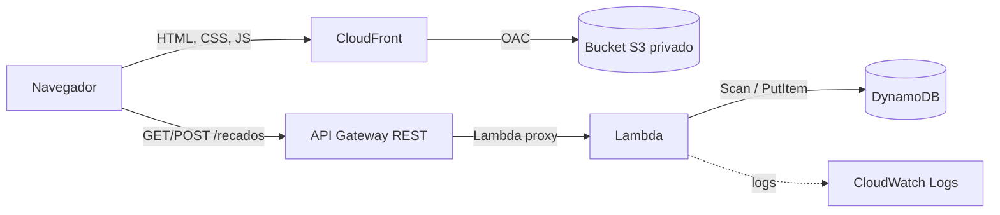

# Mural de Recados: laboratório Escola da Nuvem

Site estático onde a turma deixa recados. Ele usa uma arquitetura serverless com **S3**, **CloudFront**, **API Gateway**, **Lambda** e **DynamoDB**.

O projeto pode ser montado de duas formas:

- **Manual, pelo Console da AWS:** siga o [PASSO-A-PASSO.md](PASSO-A-PASSO.md). É o caminho pensado para os alunos.
- **Automática, com CloudFormation:** use os scripts da pasta `infra/`. É útil para o professor preparar uma demonstração.

## Arquitetura



| Serviço | Papel |
|---|---|
| S3 | Guarda os arquivos do site. O bucket é privado. |
| CloudFront | Entrega o site com HTTPS. É o único que lê o bucket, via Origin Access Control (OAC). |
| API Gateway | Expõe `GET /recados` e `POST /recados` e repassa as requisições para a Lambda. |
| Lambda | Valida os dados, gera `id` e data, e lê/grava no DynamoDB. |
| DynamoDB | Armazena os recados. |
| CloudWatch Logs | Recebe os logs da Lambda. |

## Estrutura

```
.
├── README.md
├── PASSO-A-PASSO.md      # guia de criação manual pelo console
├── infra/
│   ├── template.yaml     # todos os recursos em CloudFormation
│   ├── deploy.sh         # cria/atualiza a stack e publica Lambda e site
│   ├── destroy.sh        # apaga tudo
│   ├── status.sh         # status e eventos da stack (somente leitura)
│   ├── smoke-test.sh     # testes rápidos do ambiente publicado
│   └── aws-env.sh        # lê .aws-profile e .aws-region
├── lambda/
│   └── index.mjs         # código da Lambda (Node.js 22)
└── site/
    ├── index.html
    ├── styles.css
    ├── app.js
    └── config.js         # URL da API usada pelo site
```

## API

URL base: `https://<api-id>.execute-api.<regiao>.amazonaws.com/prod`

### `GET /recados`

Lista os recados, do mais novo para o mais antigo.

```json
[
  { "id": "6cec9f4e-...", "nome": "Ana", "mensagem": "Oi, turma!", "criadoEm": 1793142262674 }
]
```

`criadoEm` é o horário em milissegundos (epoch).

### `POST /recados`

Cria um recado. Envie `Content-Type: application/json`.

```json
{ "nome": "Ana", "mensagem": "Oi, turma!" }
```

| Status | Quando |
|---|---|
| `201` | Recado criado. Corpo: `{ "ok": true, "id": "..." }` |
| `400` | Nome ou mensagem vazios, nome com mais de 50 caracteres, mensagem com mais de 280, ou JSON inválido. Corpo: `{ "erro": "..." }` |
| `429` | Limite do stage excedido (10 req/s, rajada de 20) |
| `500` | Erro ao acessar o DynamoDB. O detalhe fica no CloudWatch Logs. |

## Deploy automatizado

### Pré-requisitos

- Conta AWS com permissão para criar os recursos acima.
- [AWS CLI v2](https://docs.aws.amazon.com/cli/latest/userguide/getting-started-install.html) com um profile configurado.
- Bash (Linux, macOS ou WSL no Windows), `curl` e `zip` ou `python3`.

### Configurar profile e região

Crie dois arquivos na raiz do projeto, cada um com uma linha. Eles estão no `.gitignore` porque cada pessoa usa os seus.

```bash
echo "meu-profile" > .aws-profile
echo "us-east-1"   > .aws-region
```

### Criar o ambiente

```bash
bash infra/deploy.sh 2>&1 | tee deploy.log
```

O script:

1. Confere a identidade AWS e se a stack `mural-recados` é deste lab.
2. Cria ou atualiza a stack com `infra/template.yaml`. O CloudFront leva de 5 a 15 minutos na primeira vez.
3. Publica o código de `lambda/index.mjs`.
4. Gera `site/config.js` com a URL da API.
5. Envia o site ao bucket e invalida o cache do CloudFront.

No final, ele mostra a URL do site e a da API. Para ver de novo:

```bash
bash infra/status.sh
```

Para usar outro nome de stack (por exemplo, uma por aluno), defina `STACK_NAME`:

```bash
STACK_NAME=mural-ana bash infra/deploy.sh
```

### Testar

```bash
bash infra/smoke-test.sh
```

O teste confere que o site carrega, que o acesso direto ao S3 é bloqueado, que o GET, o CORS e o preflight funcionam, e que um POST inválido é recusado. Ele não grava nada na tabela.

Para testar pelo Postman, faça `GET` e `POST` em `<URL da API>/recados`. O Postman não aplica CORS, então funciona mesmo com a API restrita ao domínio do CloudFront.

### Remover tudo

```bash
bash infra/destroy.sh 2>&1 | tee destroy.log
```

Esvazia o bucket e apaga a stack. **Os recados gravados são perdidos.**

## Diferenças entre o modo manual e o automatizado

| Item | Manual (`PASSO-A-PASSO.md`) | Automatizado (`infra/`) |
|---|---|---|
| Nome da tabela | `Recados` | `<stack>-recados` |
| CORS | `*` (opcionalmente restrito depois) | Restrito ao domínio do CloudFront |
| Throttling | Não configurado | 10 req/s, rajada de 20 |
| Retenção de logs | Padrão (nunca expira) | 7 dias |

No modo automatizado, abrir o `index.html` direto do computador não funciona contra a API, porque o CORS só libera o domínio do CloudFront.

## Custos

Nenhum recurso tem custo fixo por hora. Tudo é cobrado por uso, e o tráfego de uma turma costuma ficar dentro do free tier ou em centavos de dólar. O CloudFront é criado no modelo pay-as-you-go e sem AWS WAF. Apague o ambiente ao final do lab.
